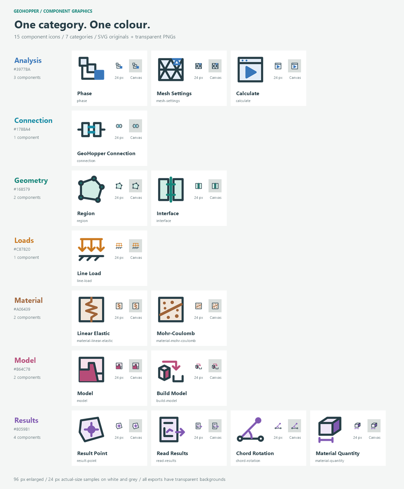

# GeoHopper

**Parametric geotechnical modelling in Grasshopper, analysed with PLAXIS 2D.**

GeoHopper is an early-stage C# plugin for Rhino 7 / Grasshopper. Define geometry,
materials, contacts, loads and construction phases in Grasshopper, run a PLAXIS
analysis, and read selected displacements and material quantities back into your
parametric workflow. The connection uses the local encrypted scripting API directly:
no Python backend or JSON exchange files are needed at runtime.

Current version: **0.4.0.1**. This is a prototype, not a validated design tool.
Rhino and PLAXIS are separate proprietary products and are not included.
GeoHopper is an independent project, not an official Seequent, Bentley or McNeel product.

## Components

The image is an icon overview, not a screenshot of a running analysis.

| Component | Purpose |
|---|---|
| GeoHopper Connection | Check the Input server and provide connection settings |
| Material - Linear Elastic | Define a non-porous elastic continuum material |
| Material - Mohr-Coulomb | Define drained soil properties |
| Region | Assign a material to a closed XY polygon and preview it |
| Model | Assemble and validate the model definition |
| Interface | Define soil-structure contact and strength reduction |
| Line Load | Apply a uniform boundary load |
| Phase | Specify construction stages and complete activation states |
| Mesh Settings | Set element size and local refinement |
| Build Model | Transfer, mesh, prepare phases and save a managed model |
| Calculate | Calculate phases and verify success |
| Result Point | Define an interior sampling location |
| Read Results | Return point displacements and settlement |
| Chord Rotation | Measure orientation change between two sampled points |
| Material Quantity | Calculate section area and extruded material volume |

See the [component catalogue](docs/COMPONENTS.md) for ports and units.

## Compatibility and installation

Tested development environment: Windows, Rhino 7 / Grasshopper and PLAXIS 2D 2025.1.
Other Rhino/PLAXIS versions are not yet verified. PLAXIS must support remote scripting;
users need their own software installations and appropriate licenses.

- Users: follow [INSTALL.md](INSTALL.md) when a packaged release is available.
- Developers: follow [docs/DEVELOPMENT.md](docs/DEVELOPMENT.md) to build from source.
- No public release download is advertised until a release has actually been published.

## Workflow

Geometry + materials -> Model -> Build Model -> Calculate -> Read Results

Build, Calculate and Read are explicit button actions. Build requires a dedicated
PLAXIS project with title `GeoHopper:<model ID>`. It saves a backup and replaces the
managed model with the current definition. Do not use an unrelated production model.
Rhino geometry is converted from document units; physical inputs and outputs use SI.
See [units and signs](docs/UNITS.md).

## Scope and limitations

The current analysis supports dry, small-deformation plane-strain continuum models,
standard supports, gravity initialization and plastic construction phases.
There are no groundwater/consolidation controls, optimizer loop or arbitrary support
components. Sampled displacement and chord rotation are not whole-model maxima.
Material volume is a quantity, not a cost estimate.

Automated tests check data validation and protocol behavior; they do not certify the
physical model or FE solution. Verify geometry, contacts, phase activation, convergence
and mesh/domain sensitivity before interpreting engineering results.
See [validation scope](tests/VALIDATION.md) and [architecture](docs/ARCHITECTURE.md).

## Examples

Grasshopper and PLAXIS demo files are intentionally withheld while they are refined.
[examples/](examples/README.md) contains placeholders for future reviewed examples.
No private model, calculation result or password-bearing GH definition is included.

## Development and contributions

The plugin source, graphics, documentation and tests are in this repository.
[CONTRIBUTING.md](CONTRIBUTING.md) explains how to report bugs and contribute changes.
See [CHANGELOG.md](CHANGELOG.md) for version history and [AGENTS.md](AGENTS.md) for
coding-agent rules. Existing component IDs and port order must remain compatible.

## License

GeoHopper source, documentation and project graphics are licensed under the
[MIT License](LICENSE). Third-party components retain their own licenses; see
[THIRD-PARTY-NOTICES.md](THIRD-PARTY-NOTICES.md).
